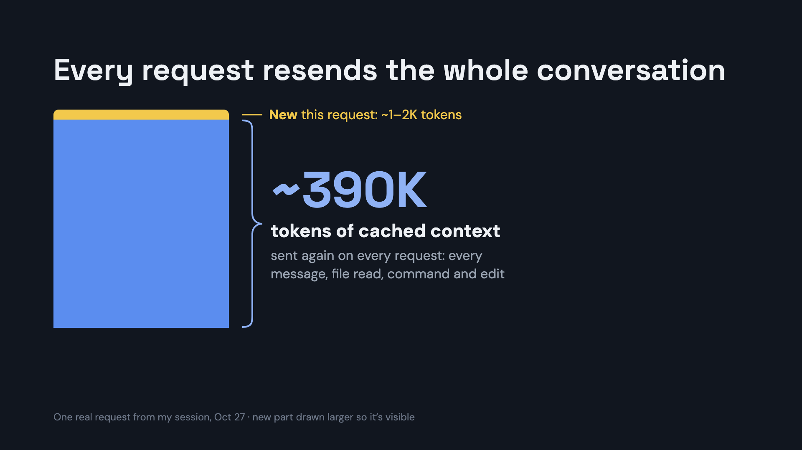
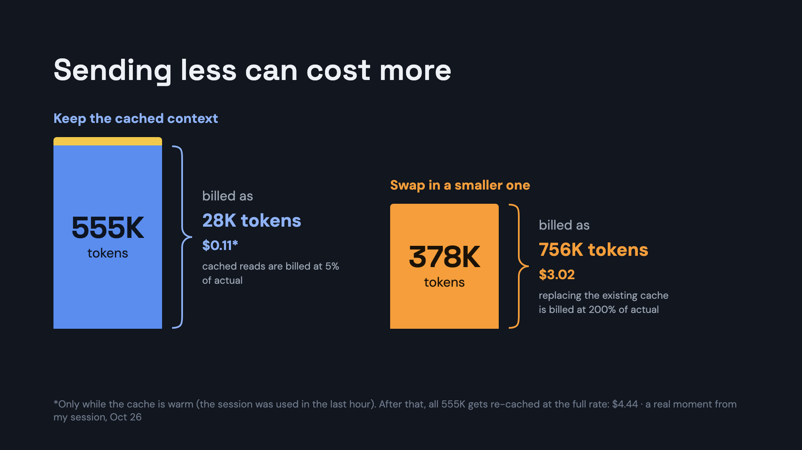
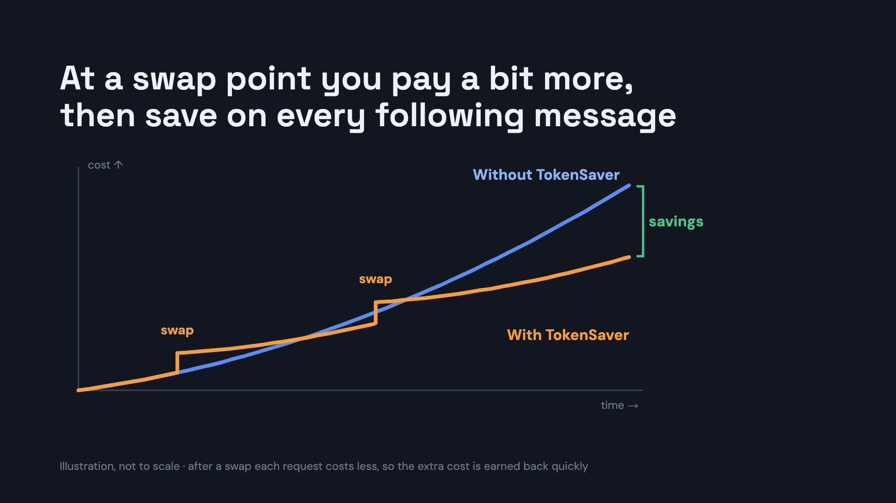
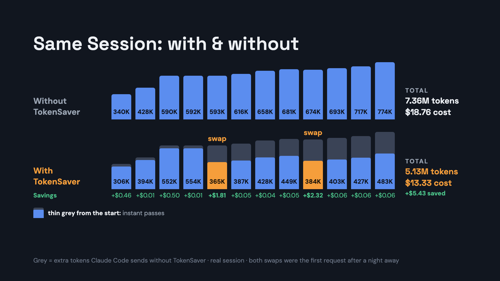
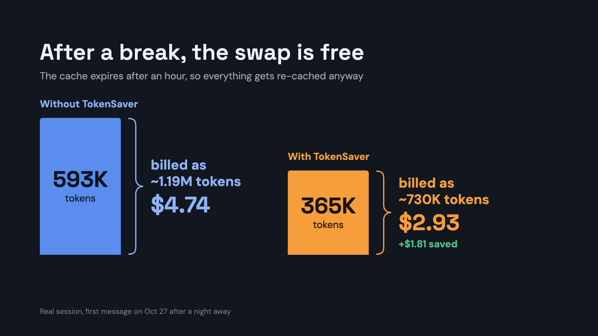
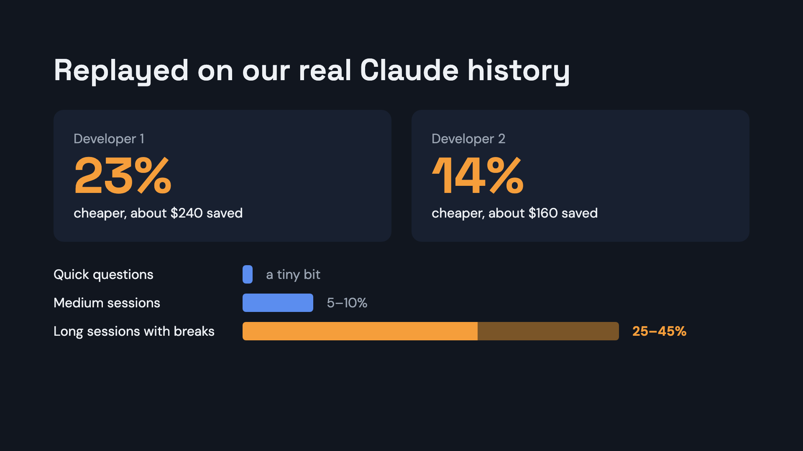

# TokenSaver

**A cheaper Claude Code bill, without changing how you work.** Install it once,
keep typing `claude` like always, and it quietly trims what Claude Code resends
on every message.

```sh
git clone https://github.com/lukeprofits/TokenSaver ~/.tokensaver/src && ~/.tokensaver/src/install.sh
```

The installer shows you everything it will change and asks once. After that,
Claude Code in your terminal, VS Code or JetBrains goes through TokenSaver
automatically. It runs on any computer, no AI model needed. You'll see a small
⚡ with the % saved in Claude Code's status line.

## How it works, in 7 slides


**It sits between Claude Code and Anthropic.** Your words and Claude's are never touched; only old copies of files and command output get trimmed.



**Every request resends the whole conversation.** That repeated part is most of your bill.



**Anthropic's cache makes resending cheap, so sending less can cost more.** Replacing the cache is the expensive part.



**So TokenSaver swaps only when it pays off:** a small one-time cost, then every request after is cheaper.



**A real session, with and without:** 30% fewer tokens over these 12 requests.



**After a break of an hour or more, the swap is free**, because the cache has expired and everything gets re-sent anyway. That's where TokenSaver saves the most.



**Replayed on real history:** the longer the session and the more breaks, the bigger the saving.

## How much it saves

Measured on 51 real Claude Code sessions (one developer, mostly Opus):

| | plain Claude Code | with TokenSaver |
|---|---|---|
| tokens sent | 100% | **71%** (29% fewer) |
| bill | 100% | **77%** (23% cheaper) |
| bill, big working sessions | 100% | 73% (27% cheaper) |
| bill, medium sessions | 100% | 93% (7% cheaper) |
| bill, quick questions | 100% | about the same |

Session sizes here count every request Claude Code makes, and it makes one
for each step: every file it reads, command it runs and edit it makes. So one
message from you is often several requests.

- **Big working sessions** are 200+ requests: typically 30–40 of your own
  messages of real coding work, often spread over a day with breaks.
- **Medium sessions** are 50–199 requests.
- **Quick questions** are under 50 requests, usually just one or two
  messages.

Big sessions with breaks in them save the most. Want your own number first?
This replays the Claude Code sessions already on your computer and changes
nothing:

```sh
git clone https://github.com/lukeprofits/TokenSaver && TokenSaver/tokensaver-cli benchmark
```

(It asks before starting: it uses Anthropic's free token counter with your
own Claude login.)

## Commands

```sh
tokensaver help          # what each command does
tokensaver status        # is it on, off or paused?
tokensaver off           # turn it off: new Claude sessions go straight to Anthropic
tokensaver pause         # off for the rest of today, back on by itself at midnight
tokensaver on            # turn it back on (also ends a pause early)
tokensaver doctor        # is it installed and working?
tokensaver --benchmark   # what it would have saved on your past sessions
tokensaver proxy --stats # what it has saved so far
tokensaver update        # get the latest version
tokensaver uninstall     # remove it completely
```

## It won't break Claude

- It never changes what you type, and never touches what Claude is working on
  right now.
- If TokenSaver stops working, Claude Code goes straight to Anthropic, the way
  it did before you installed it. That's true even if its folder gets deleted.
- It adds its own settings next to yours, keeps a backup, and changes nothing
  else. If your company already sends Claude through its own gateway,
  TokenSaver works with it or stays out of the way.
- `tokensaver uninstall` removes everything and puts back anything it
  replaced.

---

## How it works, in detail

Every time Claude Code talks to Claude, it sends **the whole conversation**
again: every file Claude read, every command output, everything said so far.
And it talks to Claude a lot: once for your message, then again after every
file it reads, command it runs or edit it makes. In a long session, resending
all that is most of your bill.

Anthropic gives a big discount for resending exactly what it has seen in the
last hour (this is called the cache). So you can't just trim the conversation
whenever you like: changing anything Claude already saw throws the discount
away and costs more than it saves. TokenSaver works around that with two kinds
of steps:

1. **On every message, it tidies only what's new**, before Claude sees it for
   the first time. Nothing Claude already saw changes, so the discount stays.
2. **When you take a long break**, long enough that the discount would expire
   anyway, it trims old command output and file contents in the older part of
   the conversation. Resending costs the same at that moment either way, so the
   trimming is free and every request after it is smaller.

The break-time trimming is not Claude Code's `/compact`. It uses no AI and
costs nothing: it's fixed rules, like the every-message ones, that keep your
words and Claude's as written and cut down the bulky output Claude already
dealt with. Claude Code's own `/compact` still works as usual.

It's a small helper program on your own computer, sitting between Claude Code
and Anthropic. It doesn't use an AI model or an API key of its own.

### Step 1: on every message (instant, nothing lost)

| what it does | typical saving |
|---|---|
| **Long scripts in commands.** When Claude runs a long inline script, the history keeps a short command pointing to an exact copy saved on your computer | the biggest one: commands about half the size, ~9% of the conversation |
| **Duplicate plans.** Plan mode puts the same plan in the history twice; one copy is kept | ~3.5%, in sessions that use plan mode |
| **JSON.** Compacts JSON output without losing anything | small for most people; a lot for JSON-heavy output |
| **Clutter.** Removes color codes and trailing spaces | under 1% |
| **Repeated lines.** A line repeated many times in a row becomes "this line, repeated N times" | helps on noisy logs |

Together these save about 2% of the bill. Small, but it's on every message and
loses nothing.

### Step 2: during long breaks (the big one)

| what it does | needs | typical saving |
|---|---|---|
| **Trim old output.** In the older part of the conversation, old command output and file contents are cut to their first lines plus any line Claude referred to later, and a short list of the names that appeared there is added. Everything you and Claude wrote stays word for word, and the most recent part stays exactly as it was | nothing, any computer | every request after it is ~39% smaller; big sessions with several breaks ~30% cheaper |
| **Short names for long paths.** Long folder paths that repeat a lot get a short name, only when that actually saves tokens | nothing | 0–2%, often skipped |
| **Drop replaced pieces.** A small local AI model finds pieces that later work replaced (an old view of a file that was then edited, an attempt that was redone) | a local model, 24 GB+ memory | ~4% more |
| **Drop repeated pieces.** A larger local model finds things that were said again later | a larger local model, 48 GB+ Mac | ~3% more |
| **Pick the lines that matter.** The larger model picks which lines of old output to keep | same | ~1% more |
| **Final check.** Before any AI-made trim is used, it quizzes both versions about the old conversation; if the trimmed one loses anything, the untrimmed one is used | same | none: it's the safety step |

Trimmed output can't be read back from the conversation, but the files are
still on disk and commands can be run again, so Claude re-reads what it needs.
If Claude starts re-reading files or re-running commands more often after
trimming, TokenSaver turns the break-time trimming off and tells you.

## More savings on powerful computers

Everything above "Drop replaced pieces" works on any computer with no AI
model. If your computer has the memory, you can add local AI models that run
on your own machine for free (through [ollama](https://ollama.com)) and trim a
little more during breaks:

| your computer | what you get |
|---|---|
| any computer | everything on every message, plus the break-time trimming |
| 24 GB+ of memory | + a small model (~9 GB download) that drops replaced pieces |
| Mac with 48 GB+ | + a larger model (~22 GB) that drops repeated pieces, trims old output, and runs the final check |

That's about 0.5–1% more saving. It's opt-in, because the downloads are big:

```sh
~/.tokensaver/src/install.sh --with-prune
```

It only installs what your computer can handle, and the models pause while
you're working the machine hard.

## The ⚡ in your status line

The % is how much less your next message sends than it would without
TokenSaver.

| you see | it means |
|---|---|
| ⚡ 23% | Saving 23%, and break-time trimming is ready: a longer break will save more |
| ⚡ 23% in green | Saving 23%, and that's as good as it gets for now |
| ⚡ with no number | Working, no measurement yet for this session |
| ⚡ 0% | Nothing to trim yet (a new or short session), or TokenSaver is passing this session through untouched |
| ⚡down in red | TokenSaver isn't answering. New sessions go straight to Anthropic; restart this one if it stops responding |

A low number early on is normal: savings grow as the conversation gets longer
and after your first long break.

## Limits

- macOS is tested. Linux should work but hasn't been tried on a real machine
  yet.
- Needs Python 3.9+ and Claude Code.
- Claude Code's Remote Control feature isn't available while TokenSaver is on
  (Claude Code turns it off for custom setups like this). Run `tokensaver off`,
  start a new Claude session for Remote Control, and `tokensaver on` afterwards.
- The Claude desktop app hasn't been tested.
- TokenSaver keeps a local copy of your sessions in `~/.tokensaver`, the same
  kind of material Claude Code already keeps in `~/.claude`. Nothing leaves
  your computer except your normal Claude traffic and the free token counts.

## License

MIT
